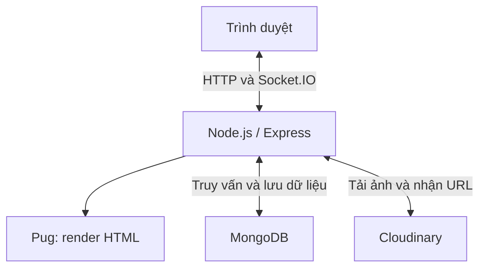
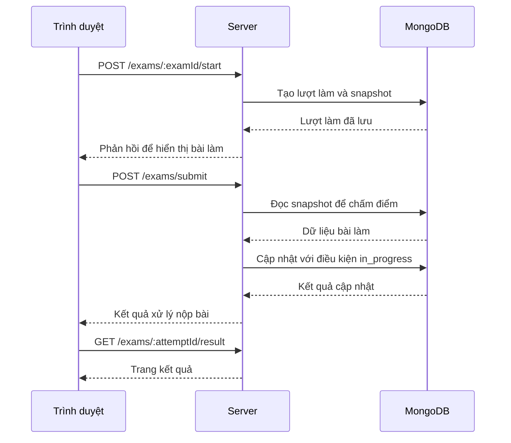

# Hệ thống ôn luyện thi tốt nghiệp THPT

Bài tập lớn môn Lập trình mạng.
## Mục lục
1. [Thông tin dự án](#1-thông-tin-dự-án)
2. [Tóm tắt dự án](#2-tóm-tắt-dự-án)
3. [Tổng quan hệ thống](#3-tổng-quan-hệ-thống)
4. [Kiến trúc hệ thống](#4-kiến-trúc-hệ-thống)
5. [Thiết kế giao tiếp mạng](#5-thiết-kế-giao-tiếp-mạng)
6. [Công nghệ sử dụng](#6-công-nghệ-sử-dụng)
7. [Đóng góp kỹ thuật](#7-đóng-góp-kỹ-thuật)
8. [Cấu trúc mã nguồn](#8-cấu-trúc-mã-nguồn)
9. [Yêu cầu môi trường](#9-yêu-cầu-môi-trường)
10. [Cài đặt và cấu hình](#10-cài-đặt-và-cấu-hình)
11. [Chạy ứng dụng](#11-chạy-ứng-dụng)
12. [Các chức năng chính và kiểm thử](#12-các-chức-năng-chính-và-kiểm-thử)
13. [Thiết lập thực nghiệm](#13-thiết-lập-thực-nghiệm)
14. [Kết quả thực nghiệm](#14-kết-quả-thực-nghiệm)
15. [Thảo luận](#15-thảo-luận)
16. [Hạn chế](#16-hạn-chế)
17. [Hướng phát triển](#17-hướng-phát-triển)
18. [Báo cáo](#18-báo-cáo)
19. [Tài liệu tham khảo](#19-tài-liệu-tham-khảo)
20. [Phân công và đóng góp](#20-phân-công-và-đóng-góp)
21. [Demo](#21-demo)
22. [Nộp bài](#22-nộp-bài)
23. [Kiểm tra trước khi nộp](#23-kiểm-tra-trước-khi-nộp)
24. [Liên hệ](#24-liên-hệ)
# 1. Thông tin dự án

### 1.1. Tên dự án

- Tên tiếng Việt: Hệ thống ôn luyện thi tốt nghiệp THPT.
- Tên tiếng Anh: THPT Practice. 


### 1.2. Topic

- Nhóm chủ đề : Chủ đề 3 – Ứng dụng mạng (Network Application)

### 1.3. Nhóm thực hiện

- Nhóm bài tập: 14. 

| STT | Mã sinh viên | Họ và tên | Nhiệm vụ chính | Đóng góp |
| --- | --- | --- | --- | ---: |
| 1 | B23DCCN226 | Phùng Văn Dương | Thiết kế kiến trúc MVC và cơ sở dữ liệu MongoDB; xây dựng backend Express, xác thực JWT cookie và phân quyền; quản lý câu hỏi và đề thi ở cả phía quản trị viên và người dùng; tích hợp thông báo realtime qua Socket.IO và tải ảnh lên Cloudinary | 50% |
| 2 | B23DCCN784 | Trần Hoàng Thiên | Triển khai nhóm học tập, duyệt thành viên và chia sẻ đề; Xây dựng snapshot dữ liệu bài làm và chức năng chấm điểm; cập nhật kết quả có điều kiện chống nộp trùng; triển khai kiểm thử tải bằng k6; kiểm thử chức năng, phân quyền và giao tiếp nhiều client; tổng hợp kết quả và biên soạn báo cáo kỹ thuật | 50% |
| | | **Tổng** | | **100%** |

### 1.4. Giảng viên hướng dẫn

MSc. Ngô Văn Quyền
## 2. Tóm tắt dự án

### 2.1. Bài toán

Xây dựng website hỗ trợ học sinh ôn luyện thi tốt nghiệp THPT,
cho phép làm đề trực tuyến, luyện tập theo môn/chuyên đề,
xem kết quả và lời giải. Người dùng có thể tự soạn ngân hàng
câu hỏi, tạo đề cá nhân và chia sẻ đề trong nhóm học tập.

Hệ thống cần chấm điểm tự động, bảo toàn nội dung bài làm
khi câu hỏi gốc thay đổi và ngăn yêu cầu nộp lặp ghi đè
kết quả đã lưu.

### 2.2. Động lực thực hiện

Dự án hướng tới việc tập trung hoạt động soạn câu hỏi,
tạo đề, làm bài và học tập theo nhóm trên cùng một hệ thống,
giúp người dùng chủ động tổ chức nội dung ôn luyện.

Trong phạm vi môn Lập trình mạng, dự án vận dụng mô hình
client–server, giao tiếp HTTP, xác thực bằng JWT cookie
và thông báo realtime qua Socket.IO.

### 2.3. Mục tiêu

1. Xây dựng website có xác thực và phân quyền người dùng,
   quản trị viên.
2. Hỗ trợ làm bài và chấm điểm tự động với ba loại câu hỏi:
   trắc nghiệm, đúng/sai và điền đáp án.
3. Cho phép quản lý câu hỏi, tạo đề cá nhân và luyện tập
   theo môn/chuyên đề.
4. Hỗ trợ nhóm học tập, chia sẻ đề và thông báo realtime.
5. Bảo toàn dữ liệu bài làm bằng snapshot và kiểm soát
   cập nhật khi có nhiều yêu cầu nộp cùng một lượt.
6. Kiểm thử chức năng và đo hiệu năng trang danh sách
   đề thi tại các mức tải khác nhau.

### 2.4. Phạm vi

#### Trong phạm vi

- Website sử dụng qua trình duyệt.
- Đăng ký, đăng nhập và phân quyền user/admin.
- Quản lý môn học, chuyên đề, câu hỏi và đề thi.
- Soạn nội dung có công thức toán và hình ảnh.
- Làm bài, chấm điểm, xem kết quả và lịch sử bài làm.
- Luyện tập theo môn/chuyên đề.
- Quản lý câu hỏi và đề thi cá nhân.
- Tạo nhóm, duyệt thành viên và chia sẻ đề trong nhóm.
- Lưu và gửi thông báo realtime.

#### Ngoài phạm vi

- Tổ chức kỳ thi chính thức có giám sát và chống gian lận.
- Nhập hàng loạt câu hỏi từ Word/Excel.
- Tự động tạo đề theo ma trận kiến thức và mức độ khó.
- Ứng dụng di động riêng. 
## 3. Tổng quan hệ thống

### 3.1. Mô tả hệ thống

THPT Practice là website ôn luyện thi tốt nghiệp THPT,
sử dụng Node.js, Express, Pug và MongoDB.

Người dùng truy cập bằng trình duyệt để làm đề, luyện tập,
soạn câu hỏi và tổ chức học tập theo nhóm. Server xử lý
xác thực, phân quyền, chấm điểm và lưu trữ dữ liệu.
Giao diện được server render bằng Pug; thông báo realtime
được gửi qua Socket.IO. Hình ảnh tải lên được lưu
trên Cloudinary.

### 3.2. Đối tượng sử dụng

- **Người dùng:** học sinh có nhu cầu ôn luyện và người có
  nhu cầu soạn câu hỏi, tạo đề hoặc tổ chức nhóm học tập.
  Sử dụng tài khoản có vai trò `user`.
- **Quản trị viên:** quản lý tài khoản và nội dung chung
  của hệ thống. Sử dụng tài khoản có vai trò `admin`.

### 3.3. Các chức năng chính

| Chức năng | Mô tả | Trạng thái |
| --- | --- | --- |
| Xác thực và phân quyền | Đăng ký, đăng nhập, đăng xuất; kiểm soát quyền user/admin bằng JWT cookie | Đã triển khai |
| Làm đề trực tuyến | Bắt đầu lượt làm, đếm ngược thời gian và nộp bài | Đã triển khai |
| Chấm điểm và xem kết quả | Chấm câu trắc nghiệm, đúng/sai, điền đáp án; hiển thị điểm và lời giải | Đã triển khai |
| Lịch sử bài làm | Xem lại các lượt làm và kết quả đã lưu | Đã triển khai |
| Luyện tập | Luyện tập ngẫu nhiên theo môn/chuyên đề | Đã triển khai |
| Ngân hàng câu hỏi cá nhân | Soạn và quản lý câu hỏi có công thức toán, hình ảnh | Đã triển khai |
| Đề thi cá nhân | Tạo và quản lý đề thi cá nhân | Đã triển khai |
| Nhóm học tập | Tạo nhóm, xin tham gia, duyệt thành viên và chia sẻ đề | Đã triển khai |
| Thông báo | Nhận thông báo realtime và xem lại thông báo đã lưu | Đã triển khai |
| Quản trị hệ thống | Quản lý môn học, chuyên đề, câu hỏi, đề thi, công thức và người dùng | Đã triển khai | 
## 4. Kiến trúc hệ thống

### 4.1. Sơ đồ kiến trúc



Trình duyệt gửi yêu cầu HTTP đến Express và nhận trang HTML
hoặc dữ liệu JSON. Socket.IO dùng chung HTTP server để
gửi thông báo realtime đến người dùng.

### 4.2. Các thành phần

| Thành phần | Trách nhiệm |
| --- | --- |
| Client | Hiển thị giao diện, nhận thao tác người dùng, gửi yêu cầu HTTP và nhận thông báo Socket.IO |
| Server | Xác thực, phân quyền, xử lý nghiệp vụ, chấm điểm và điều phối truy cập dữ liệu |
| Pug | Tạo trang HTML từ dữ liệu do server cung cấp |
| MongoDB | Lưu tài khoản, nội dung ôn luyện, bài làm, nhóm và thông báo |
| Cloudinary | Lưu trữ hình ảnh được tải lên |

Mã nguồn server được tổ chức theo mô hình MVC:
routes định tuyến yêu cầu, middlewares kiểm tra truy cập,
controllers xử lý nghiệp vụ, models thao tác dữ liệu
và views hiển thị giao diện.

### 4.3. Luồng dữ liệu

#### Luồng làm bài

1. Người dùng chọn đề và gửi yêu cầu bắt đầu làm bài.
2. Server kiểm tra quyền truy cập, tạo lượt làm và lưu
   snapshot nội dung câu hỏi, đáp án, lời giải.
3. Trình duyệt hiển thị câu hỏi và đếm ngược thời gian.
4. Người dùng nộp bài hoặc trình duyệt tự gửi bài khi hết giờ.
5. Server chấm điểm dựa trên snapshot và cập nhật kết quả
   với điều kiện lượt làm vẫn ở trạng thái `in_progress`.
6. Người dùng được chuyển đến trang kết quả.

#### Luồng tải ảnh

1. Trình duyệt gửi ảnh đến server bằng `multipart/form-data`.
2. Server kiểm tra ảnh và tải lên Cloudinary.
3. Cloudinary trả URL ảnh cho server.
4. Server trả URL để trình soạn thảo chèn ảnh vào nội dung.

#### Luồng thông báo

1. Một thao tác nghiệp vụ phát sinh thông báo.
2. Server lưu thông báo vào MongoDB.
3. Server gửi sự kiện Socket.IO đến room của tài khoản nhận.
4. Nếu đang kết nối, trình duyệt cập nhật thông báo realtime.
   Người dùng có thể xem lại thông báo đã lưu khi truy cập. 
## 5. Thiết kế giao tiếp mạng

### 5.1. Mô hình giao tiếp

Hệ thống sử dụng mô hình client–server:

- Trình duyệt gửi yêu cầu HTTP đến Express để truy cập
  trang, gửi biểu mẫu và thực hiện các thao tác nghiệp vụ.
- Server trả về trang HTML, dữ liệu JSON hoặc phản hồi
  chuyển hướng tùy chức năng.
- Socket.IO duy trì kết nối để server chủ động gửi
  thông báo đến trình duyệt.

Frontend được phục vụ cùng server, không cần khởi chạy
một ứng dụng client riêng.

### 5.2. Giao thức sử dụng

| Giao tiếp | Công nghệ | Mục đích |
| --- | --- | --- |
| Trình duyệt – Server | HTTP | Truy cập trang, xác thực, quản lý nội dung và làm bài |
| Trình duyệt – Server | Socket.IO | Gửi và nhận sự kiện thông báo realtime |
| Server – MongoDB | MongoDB Driver thông qua Mongoose | Truy vấn và lưu dữ liệu |
| Server – Cloudinary | HTTPS thông qua SDK | Tải ảnh và nhận URL ảnh |

Socket.IO hỗ trợ WebSocket và HTTP long-polling tùy cấu hình
và điều kiện kết nối; không phải giao thức WebSocket thuần.

### 5.3. Định dạng thông điệp

#### HTTP: Nộp bài

Client gửi yêu cầu `POST /exams/submit` với các header:

```http
Content-Type: application/json
Accept: application/json
```

Trình duyệt gửi kèm cookie `token` của phiên đăng nhập.
Server xác định người nộp từ JWT, không nhận `accountId`
do client cung cấp.

Ví dụ request body gồm ba loại câu hỏi:

```json
{
  "attemptId": "690600000000000000000001",
  "answers": [
    {
      "questionId": "690600000000000000000002",
      "answer": "A"
    },
    {
      "questionId": "690600000000000000000003",
      "answer": {
        "A": true,
        "B": false,
        "C": true,
        "D": false
      }
    },
    {
      "questionId": "690600000000000000000004",
      "answer": "42"
    }
  ]
}
```

| Trường | Ý nghĩa |
| --- | --- |
| `attemptId` | ID lượt làm đã tạo khi bắt đầu bài |
| `answers` | Mảng câu trả lời |
| `answers[].questionId` | ID câu hỏi tương ứng trong snapshot |
| `answers[].answer` | Đáp án người dùng gửi: chuỗi khóa lựa chọn với trắc nghiệm; object chứa boolean với đúng/sai; chuỗi với điền đáp án |

Client không gửi đáp án đúng hoặc điểm.
Server chấm dựa trên snapshot đã lưu.

Ví dụ phản hồi thành công, HTTP `200`:

```json
{
  "code": "success",
  "message": "Nộp bài thành công.",
  "attemptId": "690600000000000000000001",
  "score": 7.5,
  "maxScore": 10
}
```

| Trường | Ý nghĩa |
| --- | --- |
| `code` | Trạng thái xử lý của ứng dụng |
| `message` | Thông báo kết quả |
| `attemptId` | ID lượt làm đã nộp |
| `score` | Điểm do server tính |
| `maxScore` | Điểm tối đa của lượt làm |

Nếu lượt làm đã được nộp hoặc yêu cầu khác đã cập nhật
thành công trước đó, server trả HTTP `409`:

```json
{
  "code": "error",
  "message": "Bài làm đã được nộp."
}
```

Nếu thiếu `attemptId` hoặc `answers` không phải mảng,
server trả HTTP `400`:

```json
{
  "code": "error",
  "message": "Dữ liệu bài làm không hợp lệ."
}
```

#### Socket.IO: Thông báo realtime

Server đọc JWT từ cookie `token`, xác thực kết nối
và đưa socket vào room `account:<accountId>`.
Các tab cùng tài khoản có thể cùng tham gia room này.

**Sự kiện `notification:new`**

Sau khi lưu thông báo vào MongoDB, server phát sự kiện
`notification:new` đến room của người nhận.

Ví dụ payload:

```json
{
  "_id": "690600000000000000000005",
  "type": "group_join_request",
  "content": "Nguyễn Văn A muốn tham gia nhóm \"Ôn thi Toán\".",
  "link": "/groups/690600000000000000000006",
  "isRead": false,
  "createdAt": "2026-11-01T12:00:00.000Z"
}
```

| Trường | Ý nghĩa |
| --- | --- |
| `_id` | ID thông báo |
| `type` | Loại thông báo |
| `content` | Nội dung hiển thị |
| `link` | Đường dẫn mở khi người dùng chọn thông báo |
| `isRead` | Trạng thái đã đọc |
| `createdAt` | Thời điểm tạo thông báo |

Các giá trị `type` được định nghĩa trong model:

- `group_join_request`
- `group_join_approved`
- `group_join_rejected`
- `group_exam_published`

**Sự kiện `notification:read`**

Sau khi cập nhật thông báo thành đã đọc, server phát
`notification:read` đến room của cùng tài khoản:

```json
{
  "notificationId": "690600000000000000000005"
}
```

`notificationId` là ID thông báo vừa được đánh dấu đã đọc.

Trong implementation hiện tại, client lắng nghe cả
`notification:new` và `notification:read`, sau đó gọi lại
`GET /notifications` để lấy danh sách mới nhất và số chưa đọc.
Client không cập nhật giao diện trực tiếp chỉ từ payload event.

### 5.4. Trình tự giao tiếp



### 5.5. Xử lý lỗi

#### Xác thực và phân quyền

Middleware phân biệt yêu cầu nhận JSON dựa trên header
`Accept` có chứa `application/json`.

| Trường hợp | Phản hồi thực tế |
| --- | --- |
| Chưa đăng nhập, yêu cầu JSON | HTTP 401, JSON với `code: "error"` và `message: "Vui lòng đăng nhập để tiếp tục."` |
| Chưa đăng nhập, truy cập trang thông thường | HTTP 302, chuyển hướng đến `/auth/login` |
| User truy cập chức năng admin, yêu cầu JSON | HTTP 403, JSON với thông báo `"Bạn không có quyền truy cập."` |
| User truy cập trang admin thông thường | HTTP 403, nội dung `"Bạn không có quyền truy cập."` |

JWT hết hạn hoặc không hợp lệ được middleware xóa khỏi
cookie. Yêu cầu tiếp tục được xử lý như chưa đăng nhập.
Tài khoản không tồn tại hoặc không hoạt động cũng không
được công nhận là đã đăng nhập.

#### Nộp bài và truy cập kết quả

| Trường hợp | Mã HTTP | Thông báo |
| --- | ---: | --- |
| Thiếu `attemptId` hoặc `answers` không phải mảng | 400 | Dữ liệu bài làm không hợp lệ. |
| ID lượt làm không hợp lệ, phát sinh CastError | 400 | ID bài làm không hợp lệ. |
| Phần tử câu trả lời không hợp lệ hoặc `questionId` không phải chuỗi | 400 | Dữ liệu câu trả lời không hợp lệ. |
| Lượt làm không có dữ liệu câu hỏi | 400 | Bài làm chưa có dữ liệu câu hỏi. |
| Không tìm thấy lượt làm thuộc tài khoản đang đăng nhập | 404 | Không tìm thấy bài làm. |
| Lượt làm đã nộp hoặc yêu cầu khác đã nộp thành công trước | 409 | Bài làm đã được nộp. |

Các lỗi nộp bài trên trả JSON theo cấu trúc:

```json
{
  "code": "error",
  "message": "Bài làm đã được nộp."
}
```

Server tìm lượt làm theo cả ID và tài khoản đang đăng nhập.
Vì vậy, yêu cầu nộp bài của người khác nhận HTTP 404,
không phải HTTP 403.

Khi xem trang kết quả, lượt làm không tồn tại, không thuộc
tài khoản hoặc chưa có trạng thái `submitted` trả HTTP 404
với nội dung `"Không tìm thấy bài làm!"`.

#### Tải ảnh

| Trường hợp | Mã HTTP | Nội dung JSON |
| --- | ---: | --- |
| Không gửi file ảnh | 400 | `{"message":"Vui lòng chọn ảnh."}` |
| MIME type không thuộc JPEG, PNG, WEBP hoặc GIF | 400 | `{"message":"Chỉ nhận ảnh JPG, PNG, WEBP hoặc GIF."}` |
| File vượt 3 × 1024 × 1024 byte (3 MiB) | 400 | `{"message":"Ảnh không được vượt quá 3 MB."}` |
| Cloudinary trả lỗi trong callback tải ảnh | 500 | `{"message":"Upload ảnh thất bại."}` |

Phản hồi lỗi upload hiện chỉ có trường `message`,
không có trường `code`.

#### Đường dẫn và lỗi server

- Đường dẫn không tồn tại trả HTTP 404 với nội dung
  `"Không tìm thấy trang"`.
- Lỗi được chuyển đến middleware xử lý lỗi chung
  bằng `next(error)` trả HTTP 500 với nội dung
  `"Có lỗi xảy ra trên máy chủ"`.
- Phản hồi của middleware lỗi chung là nội dung văn bản,
  không phải JSON, kể cả khi client yêu cầu JSON.
- Lỗi truy vấn MongoDB trong quá trình xử lý request,
  nếu được chuyển đến middleware lỗi chung, cũng nhận
  phản hồi HTTP 500 này.

#### Kết nối realtime

- Socket.IO từ chối kết nối nếu thiếu token, token không
  hợp lệ hoặc tài khoản không hoạt động.
- Client nhận sự kiện `connect_error` và hiển thị
  `"Chưa kết nối realtime"`.
- Khi nhận sự kiện `disconnect`, client hiển thị
  `"Mất kết nối"`.
- Thông báo đã lưu trong MongoDB được lấy lại qua
  `GET /notifications`. Client cũng tải lại danh sách
  khi nhận `notification:new` hoặc `notification:read`.

Các lỗi kết nối Socket.IO được xử lý qua sự kiện,
không dùng cấu trúc phản hồi JSON của API nộp bài.

#### Timeout khi nộp bài

Client đặt thời hạn chờ 15 giây bằng
`AbortSignal.timeout(15000)`.

Khi fetch thất bại hoặc hết thời gian chờ, client hiển thị:

“Không kết nối được server. Giữ trang mở để thử nộp lại.”

Đây là timeout phía client, không phải phản hồi HTTP 408
hay 504 từ server. Việc client ngừng chờ không bảo đảm
server đã dừng xử lý yêu cầu.
## 6. Công nghệ sử dụng

| Nhóm | Công nghệ / Thư viện | Vai trò |
| --- | --- | --- |
| Ngôn ngữ | JavaScript | Lập trình server và xử lý tương tác trên trình duyệt |
| Môi trường thực thi | Node.js | Chạy ứng dụng phía server |
| Web framework | Express 5 | Định tuyến HTTP, middleware và xử lý yêu cầu |
| Giao diện | Pug, HTML, CSS | Render và trình bày giao diện |
| Giao tiếp realtime | Socket.IO | Gửi thông báo đến người dùng đang kết nối |
| Cơ sở dữ liệu | MongoDB | Lưu trữ dữ liệu hệ thống |
| ODM | Mongoose | Định nghĩa schema và thao tác với MongoDB |
| Xác thực | jsonwebtoken, cookie-parser | Tạo, đọc và xác minh JWT qua cookie |
| Hash mật khẩu | bcryptjs | Hash và kiểm tra mật khẩu |
| Soạn thảo | Quill, KaTeX | Soạn nội dung và công thức toán |
| Tải ảnh | Multer, Cloudinary | Tiếp nhận và lưu trữ hình ảnh |
| Cấu hình | dotenv | Đọc biến môi trường từ file `.env` |
| Nén và ghi log | compression, morgan | Nén phản hồi HTTP và ghi log truy cập |
| Quản lý gói | npm hoặc Yarn | Cài đặt thư viện và chạy script |
| Phát triển | nodemon | Tự khởi động lại server khi mã nguồn thay đổi |
| Kiểm thử tải | k6 | Đo thời gian phản hồi, thông lượng và tỷ lệ lỗi |
| Hệ điều hành thực nghiệm | Windows 11 | Chạy server, MongoDB và công cụ đo tải |

Danh sách thư viện và ràng buộc phiên bản được khai báo
trong `package.json`. File `yarn.lock` khóa phiên bản
dependency khi cài đặt bằng Yarn. 

## 7. Đóng góp kỹ thuật

### 7.1. Phương án cơ sở (Baseline)

Để làm rõ các lựa chọn thiết kế, dự án sử dụng hai phương án
cơ sở để đối chiếu:

- Lượt làm chỉ lưu tham chiếu đến câu hỏi gốc và sử dụng
  nội dung hiện tại khi xem lại hoặc chấm điểm. Khi câu hỏi
  bị chỉnh sửa, nội dung lịch sử có thể không còn phản ánh
  đúng thời điểm bắt đầu làm bài.
- Thao tác nộp bài kiểm tra trạng thái trước, sau đó cập nhật
  kết quả bằng một thao tác riêng không kèm điều kiện trạng thái.
  Nhiều yêu cầu có thể cùng vượt qua bước kiểm tra và tiếp tục
  cập nhật cùng một lượt làm.

Đây là các phương án cơ sở dùng để so sánh thiết kế,
không phải kết luận về mọi hệ thống luyện thi khác.

### 7.2. Giải pháp của dự án

#### Bảo toàn dữ liệu bằng snapshot

Khi bắt đầu lượt làm, server lưu bản sao nội dung câu hỏi,
các lựa chọn, đáp án và lời giải vào lượt làm.

Server sử dụng snapshot để chấm điểm và hiển thị kết quả,
giúp lượt làm không phụ thuộc vào những chỉnh sửa sau đó
của câu hỏi gốc.

#### Kiểm soát cập nhật kết quả

Khi lưu kết quả nộp bài, server đặt điều kiện trạng thái
`in_progress` ngay trong thao tác cập nhật MongoDB.

Chỉ lượt làm chưa hoàn tất mới được chuyển sang `submitted`.
Yêu cầu đến sau không thể dùng thao tác này để ghi đè
kết quả đã nộp.

### 7.3. Các đóng góp

| STT | Đóng góp | Ý nghĩa | Bằng chứng |
| --- | --- | --- | --- |
| 1 | Snapshot dữ liệu bài làm | Giữ nội dung tại thời điểm bắt đầu, phục vụ chấm điểm và xem lại | Mã nguồn tạo lượt làm; kiểm thử sửa câu hỏi sau khi bắt đầu |
| 2 | Cập nhật kết quả có điều kiện trạng thái | Kiểm soát chuyển trạng thái và ngăn nộp lặp ghi đè kết quả | Mã nguồn xử lý nộp bài; kiểm thử gửi lại yêu cầu nộp |

Đây là các đóng góp triển khai trong phạm vi dự án,
vận dụng những kỹ thuật đã có để giải quyết yêu cầu
bảo toàn dữ liệu và kiểm soát cập nhật.

### 7.4. So sánh phương án cơ sở và giải pháp

| Tiêu chí | Phương án cơ sở | Giải pháp của dự án |
| --- | --- | --- |
| Dữ liệu câu hỏi của lượt làm | Phụ thuộc câu hỏi gốc | Lưu snapshot trong lượt làm |
| Khi câu hỏi gốc thay đổi | Có thể ảnh hưởng việc chấm hoặc xem lại | Lượt đã tạo giữ nội dung snapshot |
| Kiểm tra trạng thái nộp | Kiểm tra riêng trước khi cập nhật | Kiểm tra trong thao tác cập nhật |
| Yêu cầu nộp lặp | Có nguy cơ ghi đè nếu thiếu điều kiện bảo vệ | Không cập nhật khi trạng thái đã là submitted |
| Chi phí lưu trữ | Ít dữ liệu sao chép hơn | Tăng dung lượng do lưu snapshot |

So sánh trên tập trung vào thiết kế và hành vi chức năng.
Dự án chưa thực hiện benchmark đối chứng hiệu năng giữa
phương án cơ sở và giải pháp đề xuất. Kết quả k6 ở phần
thực nghiệm chỉ đánh giá endpoint GET /exams. 

## 8. Cấu trúc mã nguồn

| Đường dẫn | Nội dung |
| --- | --- |
| `index.js` | Khởi tạo server, kết nối MongoDB và thiết lập Socket.IO |
| `package.json` | Khai báo thư viện và các script chạy ứng dụng |
| `yarn.lock` | Khóa phiên bản dependency khi sử dụng Yarn |
| `config/` | Cấu hình kết nối và dịch vụ |
| `routes/` | Định nghĩa các đường dẫn của người dùng và quản trị viên |
| `controllers/` | Xử lý yêu cầu và nghiệp vụ |
| `models/` | Định nghĩa schema và model Mongoose |
| `middlewares/` | Xác thực, phân quyền và xử lý tải ảnh |
| `views/` | Các template Pug |
| `public/` | CSS, JavaScript phía trình duyệt và hình ảnh |
| `services/` | Xử lý lưu và gửi thông báo |
| `sockets/` | Thiết lập kết nối và xác thực Socket.IO |
| `scripts/seed-accounts.js` | Tạo tài khoản demo |
| `tests/load/` | Script k6 và log kết quả kiểm thử tải |
| `README.md` | Giới thiệu dự án, hướng dẫn cài đặt, chạy và kiểm thử |
| `report/report.pdf` | Báo cáo đầy đủ của dự án | 

File `.env` được người chạy tạo tại thư mục gốc theo hướng dẫn
cấu hình. Không đưa thông tin bí mật thực tế vào mã nguồn công khai. 

## 9. Yêu cầu môi trường

| Thành phần | Yêu cầu |
| --- | --- |
| Node.js | Phiên bản từ 20.19 |
| Cơ sở dữ liệu | MongoDB chạy local hoặc MongoDB Atlas |
| Trình duyệt | Trình duyệt hiện đại có hỗ trợ JavaScript và cookie |
| Quản lý gói | npm đi kèm Node.js hoặc Yarn nếu muốn sử dụng thay npm |
| Lưu trữ ảnh | Tài khoản Cloudinary và thông tin cấu hình API |
| Git | Cần nếu lấy mã nguồn bằng lệnh `git clone` |
| k6 | Cài riêng nếu muốn chạy kiểm thử tải |

MongoDB phải được khởi động và có thể truy cập qua
`MONGO_URI` trước khi chạy seed hoặc sử dụng ứng dụng.

Máy chạy server cần kết nối Internet để tải ảnh lên
Cloudinary. Nếu sử dụng MongoDB Atlas, server cũng cần
kết nối đến dịch vụ Atlas.

Frontend được phục vụ cùng server, không cần cài đặt
hoặc khởi chạy một ứng dụng client riêng. 

## 10. Cài đặt và cấu hình

### 10.1. Lấy mã nguồn

```bash
git clone https://github.com/phungvanduong2101-oss/thpt-practice.git
cd thpt-practice
```

Hoặc tải và giải nén mã nguồn, sau đó mở terminal tại thư mục
chứa `package.json`.

### 10.2. Cài đặt thư viện

Sử dụng npm:

```bash
npm install
```

Hoặc Yarn:

```bash
yarn install
```

Chọn một trình quản lý gói để sử dụng trong các bước tiếp theo.

### 10.3. Cấu hình môi trường

Tạo file `.env` tại thư mục gốc:

```dotenv
MONGO_URI=mongodb://127.0.0.1:27017/THPT
JWT_SECRET=replace_with_a_long_random_secret

CLOUDINARY_CLOUD_NAME=
CLOUDINARY_API_KEY=
CLOUDINARY_API_SECRET=
```

- `MONGO_URI`: địa chỉ kết nối MongoDB. Thay bằng chuỗi kết nối
  Atlas nếu không sử dụng MongoDB local.
- `JWT_SECRET`: thay giá trị mẫu bằng chuỗi bí mật ngẫu nhiên,
  đủ dài, dùng để ký và xác minh JWT.
- `CLOUDINARY_*`: điền thông tin từ tài khoản Cloudinary khi
  sử dụng chức năng tải ảnh.

Không công khai file `.env` chứa thông tin bí mật thực tế.

### 10.4. Cơ sở dữ liệu và tài khoản demo

Khởi động MongoDB local hoặc bảo đảm kết nối Atlas đã được
cấu hình đúng trước khi chạy seed.

Không cần tạo database và collection thủ công; MongoDB tạo
khi ứng dụng tạo collection hoặc ghi dữ liệu.

Chạy lệnh tạo tài khoản demo:

```bash
npm run seed
```

Nếu dùng Yarn:

```bash
yarn seed
```

| Vai trò | Email | Mật khẩu demo |
| --- | --- | --- |
| Admin | `admin@example.com` | `Admin@123456` |
| User | `user@example.com` | `User@123456` |

Mật khẩu được hash bằng bcrypt. Nếu email đã tồn tại,
script bỏ qua tài khoản đó, không thay đổi mật khẩu hoặc quyền.

Sau khi chạy seed, có thể đăng nhập bằng các tài khoản trên.
Các bước tạo nội dung và chạy thử được trình bày ở mục tiếp theo. 
 
## 11. Chạy ứng dụng

### 11.1. Khởi động server

Chạy tại thư mục gốc của dự án.

Chế độ phát triển, tự khởi động lại khi mã nguồn thay đổi:

```bash
npm run dev
```

Hoặc:

```bash
yarn dev
```

Chạy thông thường:

```bash
npm start
```

Hoặc:

```bash
yarn start
```

Chỉ chọn một lệnh phù hợp. Giữ terminal đang chạy trong
quá trình sử dụng; nhấn `Ctrl+C` để dừng server.

### 11.2. Truy cập client

Mở trình duyệt tại:

http://localhost:3000

Ứng dụng hiện sử dụng cổng cố định `3000`.
Express phục vụ giao diện Pug cùng server,
không cần chạy frontend riêng.

Sau khi seed tài khoản:

1. Đăng nhập tại `/auth/login` bằng tài khoản admin.
2. Truy cập `/admin/dashboard`.
3. Tạo môn học → chuyên đề → câu hỏi → đề thi.
4. Xuất bản câu hỏi và đề thi cần sử dụng.
5. Đăng nhập bằng tài khoản user để chọn đề và làm bài.

### 11.3. Chạy nhiều client

Không cần khởi động thêm server.

- Mở nhiều tab với cùng tài khoản để kiểm tra thông báo
  và đồng bộ trạng thái đã đọc.
- Để sử dụng các tài khoản khác nhau đồng thời, mở các
  trình duyệt hoặc hồ sơ trình duyệt khác nhau.
  Các tab thông thường trong cùng hồ sơ dùng chung cookie
  đăng nhập.

### 11.4. Chạy kiểm thử tải

Cài k6 riêng và giữ server đang chạy.
Mở terminal khác tại thư mục gốc, chạy lần lượt:

```bash
k6 run --vus 10 --duration 1m tests/load/exams.js
k6 run --vus 50 --duration 1m tests/load/exams.js
k6 run --vus 100 --duration 1m tests/load/exams.js
```

Script gửi yêu cầu `GET /exams`, kiểm tra HTTP 200 và
nội dung HTML. Mỗi VU chờ phản hồi rồi nghỉ 1 giây.

## 12. Các chức năng chính và kiểm thử

Các trường hợp dưới đây được kiểm thử thủ công.
“Đạt” phản ánh kết quả quan sát trong các trường hợp đã thử,
không có nghĩa hệ thống không còn lỗi.

| STT | Chức năng | Trường hợp kiểm thử | Kết quả |
| --- | --- | --- | --- |
| 1 | Xác thực | Đăng ký, đăng nhập, đăng xuất; truy cập chức năng bảo vệ sau khi đăng xuất | Đạt |
| 2 | Phân quyền | Tài khoản user truy cập trang quản trị | Đạt |
| 3 | Quản lý nội dung | Tạo môn học, chuyên đề, câu hỏi và đề thi; kiểm tra dữ liệu đã lưu | Đạt |
| 4 | Chấm điểm | Làm bài có câu trắc nghiệm, đúng/sai và điền đáp án; đối chiếu điểm dự kiến | Đạt |
| 5 | Snapshot | Sửa câu hỏi gốc sau khi bắt đầu; kiểm tra lượt làm giữ nội dung cũ | Đạt |
| 6 | Nộp bài lặp | Gửi lại yêu cầu nộp cho lượt đã hoàn tất; kiểm tra kết quả không bị ghi đè | Đạt |
| 7 | Quyền sở hữu bài làm | Truy cập hoặc nộp lượt làm của tài khoản khác | Đạt |
| 8 | Nhóm học tập | Xin tham gia, duyệt thành viên và chia sẻ đề trong nhóm | Đạt |
| 9 | Realtime nhiều client | Mở hai tab cùng tài khoản; kiểm tra nhận thông báo và đồng bộ trạng thái đã đọc | Đạt |
| 10 | Thông báo đã lưu | Truy cập lại sau khi offline; kiểm tra xem được thông báo phát sinh | Đạt |
| 11 | Kiểm tra ảnh tải lên | Tải ảnh sai định dạng hoặc vượt giới hạn dung lượng cấu hình | Đạt |
| 12 | Lỗi dịch vụ | Kiểm tra phản hồi khi thao tác với MongoDB hoặc Cloudinary thất bại | Đạt | 
## 13. Thiết lập thực nghiệm

### 13.1. Môi trường

| Thành phần | Cấu hình |
| --- | --- |
| Hệ điều hành | Windows 11 |
| CPU | Intel Core i7-11800H |
| RAM | 16 GB |
| Node.js | v24.12.0 |
| MongoDB | Chạy local |
| Công cụ đo tải | k6 v2.3.0 |
| Triển khai | Server, MongoDB và k6 chạy trên cùng một máy |
| Địa chỉ truy cập | http://localhost:3000 |

Các số liệu phản ánh môi trường thử nghiệm trên localhost,
chưa bao gồm độ trễ mạng khi triển khai từ xa.

### 13.2. Dữ liệu thử nghiệm

Dữ liệu tại thời điểm đo gồm:

- 4 môn học.
- 60 câu hỏi.
- 10 đề thi.

Script seed tài khoản không thay thế cho việc chuẩn bị
dữ liệu môn học, câu hỏi và đề thi.

### 13.3. Kịch bản kiểm thử tải

Mục đích: đánh giá thời gian phản hồi, thông lượng và
tỷ lệ lỗi của chức năng xem danh sách đề khi tăng tải.

| Kịch bản | Endpoint | Số VUs | Thời gian |
| --- | --- | ---: | --- |
| 1 | GET /exams | 10 | 60 giây |
| 2 | GET /exams | 50 | 60 giây |
| 3 | GET /exams | 100 | 60 giây |

Trong mỗi kịch bản:

- Mỗi VU gửi yêu cầu, chờ phản hồi rồi nghỉ 1 giây
  trước khi gửi yêu cầu tiếp theo.
- Kiểm tra mã HTTP 200 và nội dung HTML.
- Mỗi mức tải chạy một lần.
- Các mức tải được chạy lần lượt, không chạy đồng thời.

Script: `tests/load/exams.js`.
Lệnh chạy được trình bày tại mục 11.4.

### 13.4. Chỉ số đánh giá

| Chỉ số | Ý nghĩa |
| --- | --- |
| Thời gian phản hồi trung bình | Giá trị trung bình của `http_req_duration` |
| p50 | 50% yêu cầu có thời gian phản hồi không vượt giá trị này |
| p95 | 95% yêu cầu có thời gian phản hồi không vượt giá trị này |
| Throughput | Số yêu cầu mỗi giây do k6 báo cáo |
| Tổng request | Tổng số yêu cầu HTTP trong lần chạy |
| Tỷ lệ lỗi HTTP | Giá trị `http_req_failed` do k6 ghi nhận |
| Checks | Tỷ lệ đạt các kiểm tra HTTP 200 và nội dung HTML |

Số VUs là mức tải người dùng ảo được cấu hình,
không đồng nghĩa với số người dùng thực tế mà toàn bộ
hệ thống có thể phục vụ.

Thực nghiệm chỉ đánh giá endpoint GET /exams.
Chưa đo mức sử dụng CPU/RAM và chưa benchmark
các chức năng khác. 

## 14. Kết quả thực nghiệm

### 14.1. Kết quả kiểm thử chức năng

Các trường hợp kiểm thử thủ công tại mục 12 đạt kết quả
mong đợi trong phạm vi đã thử:

- Các thao tác xác thực, phân quyền và quản lý nội dung
  hoạt động theo kịch bản.
- Bài làm giữ nguyên snapshot sau khi câu hỏi gốc thay đổi.
- Gửi lại yêu cầu nộp không ghi đè kết quả đã lưu.
- Hai tab cùng tài khoản nhận thông báo và đồng bộ
  trạng thái đã đọc.
- Người dùng truy cập lại có thể xem thông báo đã lưu.

Kết quả nộp lặp không được sử dụng để thay thế cho
kết quả kiểm thử nhiều yêu cầu nộp đồng thời.

### 14.2. Kết quả kiểm thử tải

Kết quả đo GET /exams theo thiết lập tại mục 13:

| VUs | Tổng request | Trung bình (ms) | p50 (ms) | p95 (ms) | Request/giây | Lỗi HTTP |
| ---: | ---: | ---: | ---: | ---: | ---: | ---: |
| 10 | 580 | 41.50 | 37.04 | 49.20 | 9.56 | 0% |
| 50 | 1706 | 783.55 | 770.90 | 886.00 | 27.63 | 0% |
| 100 | 1739 | 2560 | 2580 | 3060 | 27.16 | 0% |

Hai kiểm tra mã HTTP 200 và nội dung HTML đều đạt 100%
trong các lần chạy.

Log kết quả:

- [10 VUs](tests/load/result-10.txt)
- [50 VUs](tests/load/result-50.txt)
- [100 VUs](tests/load/result-100.txt)

### 14.3. So sánh giữa các mức tải

- Từ 10 lên 50 VUs, thông lượng tăng từ 9.56 lên
  27.63 request/giây; p95 tăng từ 49.20 lên 886 ms.
- Từ 50 lên 100 VUs, thông lượng gần như không tăng,
  trong khi p95 tăng từ 886 lên 3060 ms.
- Không ghi nhận lỗi HTTP trong các lần chạy đã báo cáo.

Đây là so sánh giữa các mức tải của cùng một hệ thống.
Dự án chưa thực hiện benchmark đối chứng giữa baseline
và giải pháp đề xuất. 

## 15. Thảo luận

### 15.1. Mức độ đáp ứng mục tiêu

Trong các trường hợp kiểm thử thủ công đã thực hiện,
hệ thống đáp ứng các chức năng được liệt kê tại mục 12.
Snapshot giữ nội dung bài làm khi câu hỏi gốc thay đổi;
yêu cầu nộp lặp không ghi đè kết quả đã lưu.

Kiểm thử tải GET /exams không ghi nhận lỗi HTTP
tại các mức 10, 50 và 100 VUs. Tuy nhiên, kết quả này
chỉ phản ánh endpoint và môi trường đã thử nghiệm.

### 15.2. Ảnh hưởng khi tăng tải

Ở 10 VUs, thời gian phản hồi p95 là 49.20 ms.
Khi tăng lên 50 VUs, thông lượng tăng lên
27.63 request/giây, đồng thời p95 tăng lên 886 ms.

Khi tăng từ 50 lên 100 VUs, thông lượng gần như
không tăng nhưng p95 tăng lên 3060 ms.
Kết quả cho thấy dấu hiệu bão hòa trong môi trường đo:
thêm người dùng ảo làm tăng thời gian chờ,
không giúp tăng số yêu cầu xử lý mỗi giây.

Thông lượng còn chịu ảnh hưởng bởi mô hình tải:
mỗi VU chờ phản hồi rồi nghỉ 1 giây trước yêu cầu tiếp theo.
Vì vậy, không xem số request/giây này là giới hạn
công suất tuyệt đối của hệ thống.

### 15.3. Nút thắt và giới hạn phân tích

Một yêu cầu GET /exams bao gồm xử lý tại Express,
truy vấn MongoDB và render HTML bằng Pug.

Thực nghiệm chưa đo riêng thời gian từng bước,
mức sử dụng CPU/RAM hoặc độ trễ truy vấn.
Do đó, chưa đủ bằng chứng để xác định thành phần
gây nghẽn chính.

Server, MongoDB và k6 chạy cùng máy nên có thể
cạnh tranh tài nguyên. Kết quả không đại diện trực tiếp
cho triển khai trên nhiều máy hoặc qua Internet.

### 15.4. Ưu điểm và đánh đổi

- Snapshot giúp bảo toàn nội dung lịch sử nhưng tăng
  dung lượng lưu trữ do sao chép dữ liệu câu hỏi.
- Cập nhật có điều kiện trạng thái bảo vệ kết quả
  đã nộp; cần kiểm thử đồng thời riêng để kiểm chứng
  hành vi khi nhiều yêu cầu đến cùng lúc.
- Thông báo được lưu trước khi phát realtime,
  hỗ trợ xem lại khi người dùng truy cập sau.
  Hai bước lưu và phát không phải một thao tác nguyên tử.

### 15.5. Giới hạn thực nghiệm

- Chỉ đo tải endpoint GET /exams.
- Dữ liệu thử nghiệm còn nhỏ: 60 câu hỏi và 10 đề thi.
- Mỗi mức tải chỉ chạy một lần, chưa đánh giá
  mức biến động giữa nhiều lần đo.
- Chưa đo CPU/RAM, tải kéo dài hoặc các thao tác
  ghi dữ liệu đồng thời.
- Kiểm thử chức năng được thực hiện thủ công,
  chưa có bộ kiểm thử tự động. 

  ## 16. Hạn chế

1. **Soạn đề còn thủ công:** chưa hỗ trợ nhập hàng loạt
   câu hỏi từ Word/Excel hoặc tự động tạo đề theo
   ma trận kiến thức và mức độ khó.

2. **Chống gian lận còn hạn chế:** chưa kiểm soát việc
   người dùng tra cứu tài liệu hoặc sử dụng công cụ
   bên ngoài trong quá trình làm bài; chưa phù hợp
   để thay thế hệ thống thi chính thức có giám sát.

3. **Soạn hình minh họa còn bất tiện:** trình soạn thảo
   hỗ trợ công thức toán và chèn ảnh nhưng chưa có
   công cụ vẽ trực tiếp đồ thị hoặc hình học.

4. **Snapshot làm tăng dung lượng lưu trữ:** nội dung
   câu hỏi được sao chép vào từng lượt làm để bảo toàn
   lịch sử, dẫn đến dữ liệu trùng lặp.

5. **Lưu và phát thông báo chưa nguyên tử:** thông báo
   được lưu vào MongoDB trước khi phát qua Socket.IO.
   Nếu bước phát thất bại, người dùng có thể chưa nhận
   được thông báo ngay dù dữ liệu đã được lưu. 

## 17. Hướng phát triển

1. **Nhập câu hỏi hàng loạt:** hỗ trợ nhập từ Word/Excel,
   kiểm tra dữ liệu và xem trước trước khi lưu.

2. **Tạo đề theo ma trận:** chọn câu hỏi theo môn,
   chuyên đề, loại câu hỏi và mức độ nhận thức.

3. **Cải thiện công cụ soạn thảo:** bổ sung công cụ
   vẽ đồ thị và hình học để tạo nội dung minh họa.

4. **Tăng độ tin cậy của thông báo:** bổ sung cơ chế
   ghi nhận và thử lại khi phát thông báo thất bại,
   đồng thời tránh hiển thị trùng khi gửi lại.

## 18. Báo cáo

Báo cáo đầy đủ trình bày bài toán, cơ sở lý thuyết,
thiết kế, triển khai và kết quả thực nghiệm của dự án.

[Báo cáo đầy đủ](report/report.pdf)
 
## 19. Tài liệu tham khảo

1. [Node.js Documentation](https://nodejs.org/en/docs)
   — Môi trường thực thi JavaScript phía server.

2. [Express Documentation](https://expressjs.com/)
   — Định tuyến HTTP, middleware và xử lý yêu cầu.

3. [Pug Documentation](https://pugjs.org/)
   — Template và render giao diện HTML.

4. [MongoDB Documentation](https://www.mongodb.com/docs/)
   — Lưu trữ, truy vấn và cập nhật dữ liệu.

5. [Mongoose Documentation](https://mongoosejs.com/docs/)
   — Schema, model và thao tác với MongoDB.

6. [Socket.IO Documentation](https://socket.io/docs/v4/)
   — Kết nối realtime, sự kiện và room.

7. [jsonwebtoken](https://github.com/auth0/node-jsonwebtoken)
   — Tạo và xác minh JWT.

8. [bcrypt.js](https://github.com/dcodeIO/bcrypt.js)
   — Hash và kiểm tra mật khẩu.

9. [Quill Documentation](https://quilljs.com/docs/quickstart)
   — Trình soạn thảo nội dung.

10. [KaTeX Documentation](https://katex.org/docs/api)
    — Hiển thị công thức toán.

11. [Cloudinary Node.js Documentation](https://cloudinary.com/documentation/node_integration)
    — Tải lên và quản lý hình ảnh.

12. [Grafana k6 Documentation](https://grafana.com/docs/k6/latest/)
    — Xây dựng kịch bản và đọc kết quả kiểm thử tải. 
 
## 20. Phân công và đóng góp

Phân công công việc và tỷ lệ đóng góp của hai thành viên
được trình bày tại [mục 1.3 — Nhóm thực hiện](#13-nhóm-thực-hiện).

## 21. Demo

### 21.1. Môi trường demo

- Server và MongoDB chạy trên máy demo.
- Truy cập tại `http://localhost:3000`.
- Sử dụng hai trình duyệt hoặc hai hồ sơ trình duyệt
  để đăng nhập các tài khoản khác nhau.
- Chuẩn bị tài khoản admin và hai tài khoản user.
- Chuẩn bị môn học, chuyên đề, câu hỏi và đề đã xuất bản.
- Cấu hình Cloudinary và kết nối Internet nếu demo tải ảnh.

Script seed tạo một admin và một user.
Tài khoản user thứ hai có thể tạo qua chức năng đăng ký.

### 21.2. Các bước demo

#### Bước 1: Khởi động và đăng nhập

1. Khởi động MongoDB và server theo mục 10–11.
2. Đăng nhập tài khoản admin.
3. Giới thiệu các trang quản trị và dữ liệu đã chuẩn bị.

#### Bước 2: Soạn câu hỏi và tạo đề

1. Tạo câu hỏi thuộc môn học và chuyên đề.
2. Minh họa nhập công thức toán.
3. Chèn ảnh nếu đã cấu hình Cloudinary.
4. Tạo đề, chọn câu hỏi và xuất bản.

#### Bước 3: Làm bài và xem kết quả

1. Đăng nhập tài khoản user trên trình duyệt khác.
2. Chọn đề và bắt đầu làm bài.
3. Trả lời câu hỏi rồi nộp bài.
4. Xem điểm, đáp án, lời giải và lịch sử bài làm.

#### Bước 4: Minh họa snapshot

1. User bắt đầu một lượt làm bài mới.
2. Admin sửa nội dung một câu hỏi thuộc đề đó.
3. User hoàn tất và nộp bài.
4. Đối chiếu nội dung trong kết quả với câu hỏi đã sửa,
   minh họa lượt làm vẫn sử dụng snapshot ban đầu.

#### Bước 5: Nhóm học tập và thông báo

1. User thứ nhất tạo nhóm.
2. User thứ hai xin tham gia.
3. Chủ nhóm nhận thông báo và duyệt yêu cầu.
4. Chia sẻ đề vào nhóm để thành viên truy cập.

#### Bước 6: Minh họa nhiều client

1. Mở hai tab cùng tài khoản nhận thông báo.
2. Dùng tài khoản khác thực hiện thao tác phát sinh thông báo.
3. Quan sát thông báo xuất hiện trên hai tab.
4. Đánh dấu đã đọc ở một tab và kiểm tra tab còn lại.

## 22. Nộp bài

### 22.1. Mã nguồn

Mã nguồn được nộp qua Google Drive theo đường dẫn
và thời hạn do giảng viên thông báo.

Gói mã nguồn gồm:

- Mã nguồn ứng dụng.
- `package.json` và `yarn.lock`.
- `README.md` hướng dẫn cài đặt, chạy và kiểm thử.
- File `.env.example` chứa cấu hình mẫu.
- Script seed tài khoản demo.
- Script kiểm thử tải và log kết quả.
- Sơ đồ kiến trúc và tài liệu liên quan.

Không đưa thư mục `node_modules` hoặc file `.env`
chứa thông tin bí mật thực tế vào gói nộp.
Người chạy cài thư viện theo hướng dẫn tại mục 10.

### 22.2. Báo cáo

Báo cáo đầy đủ: [report/report.pdf](report/report.pdf).

Báo cáo được kiểm tra bằng Compilatio theo yêu cầu
của học phần.

### 22.3. Kiểm tra gói nộp

- Có đủ mã nguồn và các file cấu hình mẫu.
- Các đường dẫn tài liệu trong README hoạt động.
- Có hướng dẫn chuẩn bị dữ liệu và tài khoản demo.
- Có script kiểm thử và kết quả thực nghiệm đã báo cáo.
- Link Google Drive cho phép giảng viên truy cập.
 
## 23. Kiểm tra trước khi nộp

## 23. Kiểm tra trước khi nộp

- [x] Cài đặt thư viện thành công từ mã nguồn nộp.
- [x] Server khởi động và kết nối được MongoDB.
- [x] Trình duyệt truy cập được giao diện.
- [x] Script seed tạo được tài khoản demo.
- [x] Các chức năng chính hoạt động.
- [x] Giao tiếp HTTP và Socket.IO được mô tả.
- [x] Đã kiểm thử nhiều client.
- [x] Đã kiểm thử phân quyền và xử lý lỗi.
- [x] Script kiểm thử tải chạy được.
- [x] Số liệu thực nghiệm khớp với log kết quả.
- [x] Môi trường, dữ liệu và lệnh kiểm thử được ghi rõ.
- [x] Đóng góp kỹ thuật được trình bày rõ.
- [x] README có đủ hướng dẫn cài đặt và chạy.
- [x] Báo cáo đầy đủ và liên kết mở được.
- [x] Có tài liệu tham khảo và trích dẫn trong báo cáo.
- [x] Kết quả Compilatio không vượt quá 20%.
- [x] Thông tin thành viên và tỷ lệ đóng góp đã thống nhất.
- [x] Gói nộp không chứa thông tin bí mật thực tế.
- [x] Link Google Drive cho phép giảng viên truy cập.
- [x] Tất cả thành viên hiểu phần việc và luồng chính của hệ thống.

## 24. Liên hệ

- Đại diện nhóm: Phùng Văn Dương. 
- Email: phungvanduong2101@gmail.com
- Nhóm bài tập: 14.
- Lớp học phần: Lập trình mạng

